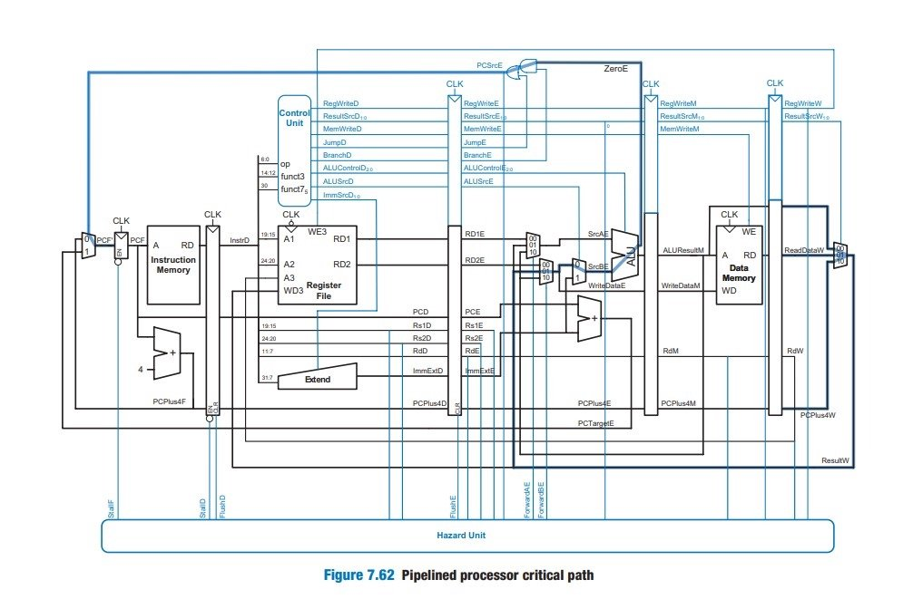
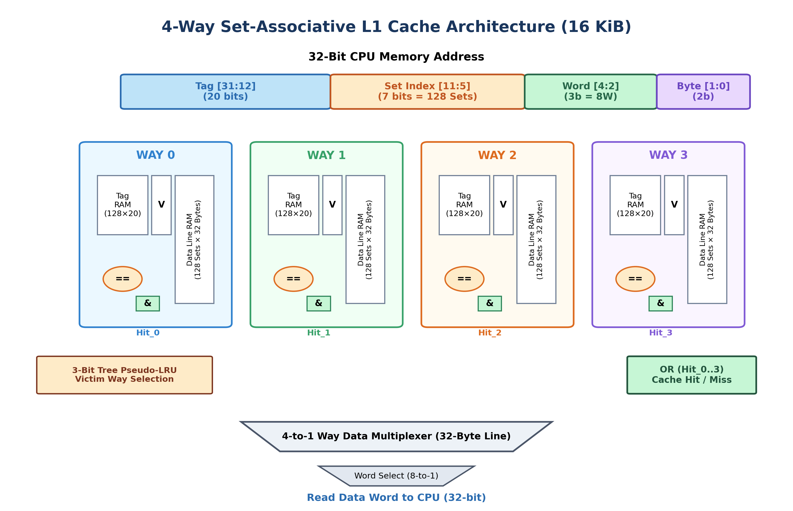
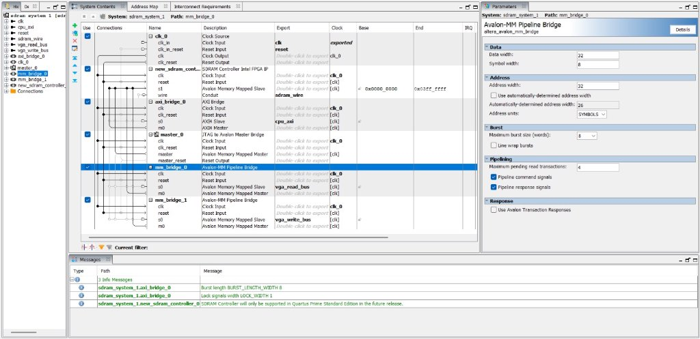
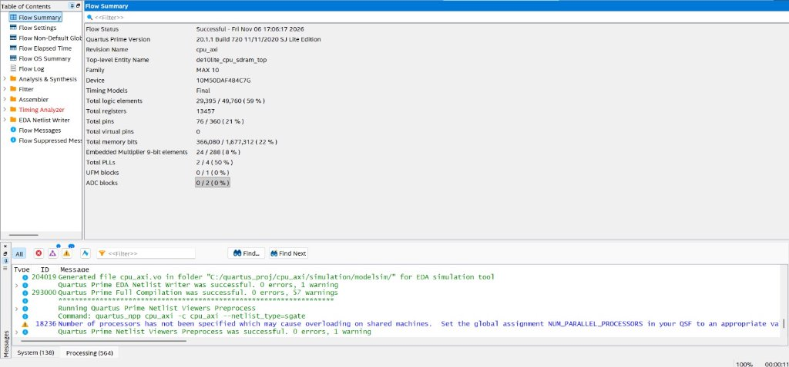

# CPU_AXI — 32-Bit RV32IM Pipelined RISC-V SoC with 4-Way L1 Caches, AXI4 SDRAM & VGA Subsystem


-blue.svg)


**CPU_AXI** is a complete, from-scratch, FPGA-oriented 32-bit RISC-V System-on-Chip (SoC) written in Verilog HDL and synthesized for the **Terasic DE10-Lite** (Intel MAX 10 FPGA). It integrates a five-stage pipelined **RV32IM** processor core, a split **Harvard L1 Cache hierarchy** (16 KiB I-Cache + 16 KiB D-Cache), a custom 5-channel **AXI4 Master** bridge, an **Intel Platform Designer (Qsys)** AXI-to-Avalon-MM interconnect driving 64 MiB of off-chip SDR SDRAM, deterministic cache-bypassing **Memory-Mapped I/O (MMIO)**, and a **640×480 @ 60Hz VGA** hardware graphics display pipeline.

* **GitHub Repository:** [https://github.com/Adi-pixel26/cpu_axi](https://github.com/Adi-pixel26/cpu_axi)
* **RTL Source & Netlist Modules:** [`code/`](https://github.com/Adi-pixel26/cpu_axi/tree/main/code) | [`code/components/`](https://github.com/Adi-pixel26/cpu_axi/tree/main/code/components) | [`firmware/`](https://github.com/Adi-pixel26/cpu_axi/tree/main/firmware)

---

## System Architecture Overview

```text
                         +-----------------------------------+
                         |      Five-Stage RV32IM Core       |
                         |   IF  ->  ID  ->  EX  -> MEM -> WB|
                         +---------+---------------+---------+
                                   |               |
                     Instruction   |               |   Load / Store + Byte Mask
                     Fetch (PCF)   |               |   (ALUResultM / WriteDataM)
                                   v               v
                  +--------------------+       +--------------------+
                  |  16 KiB L1 I-Cache |       |  16 KiB L1 D-Cache |
                  |  4-Way, 128 Sets   |       |  4-Way, 128 Sets   |
                  |  32B Line, pLRU    |       |  Write-Back, pLRU  |
                  +---------+----------+       +---------+----------+
                             \                          /   |
                              \                        /    | Uncached Bypass
                               v                      v     | (0x04xx_xxxx)
                         +--------------------------------+ |
                         |   I/D Cache Memory Arbiter     | |
                         |     (D-Cache Priority)         | |
                         +---------------+----------------+ |
                                         |                  v
                         +---------------+----------------+ +------------------+
                         |   Cache-to-AXI Bridge          | | FPGA-Local MMIO  |
                         |   (8x 32-bit Word Refill/Evict)| | - User LEDs      |
                         +---------------+----------------+ | - Switches/Keys  |
                                         |                  +------------------+
                         +---------------+----------------+
                         |   5-Channel AXI4 Master        |
                         |   (AW, W, B, AR, R Channels)   |
                         +---------------+----------------+
                                         |
             +---------------------------v---------------------------+
             |      Intel Platform Designer (sdram_system_1.qsys)    |
             |  - axi_bridge_0 (AXI4 Slave to Master Bridge)         |
             |  - mm_bridge_0  (Avalon-MM vga_read_bus, Burst = 8)   |
             |  - mm_bridge_1  (Avalon-MM vga_write_bus)             |
             |  - master_0     (JTAG to Avalon Master Debug Bridge)  |
             |  - Async CDC FIFOs & 32-bit to 16-bit Width Adapter   |
             +---------------------------+---------------------------+
                                         |
                         +---------------v----------------+
                         | 64 MiB Off-Chip SDR SDRAM      |
                         | (16-Bit Physical Data Bus)     |
                         +--------------------------------+
```

---

## Part 1: CPU Core Architecture, Pipeline Stages & RV32IM Execution

The processor (`code/riscv_cpu.v` and submodules in `code/components/`) implements a classic five-stage pipelined datapath (`IF -> ID -> EX -> MEM -> WB`) with full data forwarding, load-use hazard interlocking, control-flow branch/jump flushing, and multi-cycle execution freezing.


*Figure 1: Five-stage pipelined processor critical path, inter-stage architectural registers, forwarding multiplexers, and Hazard Unit control paths.*

### 1.1 Five-Stage Datapath & Inter-Stage Architectural Registers

State transitions across the pipeline are synchronized by four dedicated inter-stage architectural pipeline registers equipped with synchronous clear (`CLR`/`Flush`) and enable (`EN`/`!Stall`) controls:

1. **Instruction Fetch (`IF`) & `IF/ID` Register:**
   * Maintains the Fetch Program Counter (`PCF`). A dedicated adder computes `PCPlus4F = PCF + 4` every clock cycle, while the input PC multiplexer selects between sequential execution (`PCPlus4F`) and branch/jump target addresses (`PCTargetE` / ALU target) driven by `PCSrcE`.
   * `PCF` drives the read request port of the 16 KiB L1 Instruction Cache.
   * **`IF/ID` Pipeline Register:** Latches `InstrD`, `PCD`, and `PCPlus4D`. Controlled by `!StallD` (enable) to freeze during load-use interlocks or cache misses, and `FlushD` (clear) to squash fetched instructions when a branch or jump is taken in `EX`.

2. **Instruction Decode (`ID`) & `ID/EX` Register:**
   * Slices the 32-bit instruction into architectural fields: `op = InstrD[6:0]`, `rd = InstrD[11:7]`, `funct3 = InstrD[14:12]`, `rs1 = InstrD[19:15]`, `rs2 = InstrD[24:20]`, and `funct7 = InstrD[31:25]`.
   * **Register File:** 32 × 32-bit architectural registers (`x0`–`x31`, where `x0` is hardwired to `0`). Supports dual read ports (`A1 -> RD1`, `A2 -> RD2`) and a synchronous/write-through writeback port (`A3`, `WD3`, `WE3`). Because `rs1`, `rs2`, and `rd` always sit in fixed bit positions across all instruction formats, register file reading begins before opcode decoding finishes.
   * **Immediate Extend Unit (`Extend`):** Sign-extends immediate bitfields from `InstrD[31:7]` into a 32-bit `ImmExtD` based on `ImmSrcD`. Because bit 31 of the instruction is anchored as the sign bit across every immediate format, sign-extension is kept off the critical timing path.
   * **Control Unit:** Decodes `op`, `funct3`, and `funct7_5` to generate pipeline control signals: `RegWriteD`, `ResultSrcD[1:0]`, `MemWriteD`, `JumpD`, `BranchD`, `ALUControlD`, `ALUSrcD`, and `ImmSrcD`.
   * **`ID/EX` Pipeline Register:** Latches control signals (`RegWriteE`, `ResultSrcE`, `MemWriteE`, `JumpE`, `BranchE`, `ALUControlE`, `ALUSrcE`), data values (`RD1E`, `RD2E`, `PCE`, `ImmExtE`, `PCPlus4E`), and register numbers (`Rs1E`, `Rs2E`, `RdE`). Synchronous clear (`FlushE`) inserts a safe NOP bubble on load-use hazards or control-flow redirects.

3. **Execute (`EX`) & `EX/MEM` Register:**
   * **3-to-1 Forwarding Multiplexers:** Resolve Read-After-Write (RAW) hazards prior to ALU entry:
     * `SrcAE` selects between `RD1E` (`00`), writeback result `ResultW` (`01`), or prior ALU result `ALUResultM` (`10`) controlled by `ForwardAE[1:0]`.
     * The B-operand forwarding mux selects between `RD2E` (`00`), `ResultW` (`01`), or `ALUResultM` (`10`) via `ForwardBE[1:0]` to form `WriteDataE`. A secondary 2-to-1 mux controlled by `ALUSrcE` selects between `WriteDataE` and `ImmExtE` to produce `SrcBE`.
   * **ALU & Branch Target Adder:** Computes arithmetic/logical operations (`ALUResultE`) and branch comparisons (`ZeroE`, signed/unsigned relational flags). Simultaneously, a dedicated branch adder computes `PCTargetE = PCE + ImmExtE` (or register-offset targets for `JALR`).
   * **Branch Resolution:** `PCSrcE = (BranchE & BranchConditionE) | JumpE` redirects the PC and asserts `FlushD` and `FlushE`.
   * **`EX/MEM` Pipeline Register:** Latches `RegWriteM`, `ResultSrcM[1:0]`, `MemWriteM`, `ALUResultM`, `WriteDataM`, `RdM`, and `PCPlus4M`.

4. **Memory (`MEM`) & `MEM/WB` Register:**
   * **Load/Store Adapter (`code/load_store_adapter.v`):** Bridges byte, halfword, and word memory instructions (`lb`, `lh`, `lw`, `lbu`, `lhu`, `sb`, `sh`, `sw`) to the 32-bit word-aligned L1 D-Cache. Generates 4-bit byte-enable strobes (`wstrb`) for sub-word stores and performs sign-extension or zero-extension on byte (`[7:0]`) and halfword (`[15:0]`) loads based on `funct3` and byte offset `ALUResultM[1:0]`.
   * **`MEM/WB` Pipeline Register:** Latches `RegWriteW`, `ResultSrcW[1:0]`, `ALUResultW`, `ReadDataW`, `RdW`, and `PCPlus4W`.

5. **Writeback (`WB`):**
   * A 3-to-1 multiplexer controlled by `ResultSrcW[1:0]` selects between `ALUResultW` (`00`), `ReadDataW` (`01`), and `PCPlus4W` (`10`) to drive `ResultW` back into the Register File (`WD3`) and the Execute stage forwarding paths.

---

### 1.2 RV32IM Instruction Set Architecture & Encoding Formats

Every instruction is 32 bits wide and follows six core encoding formats from the RISC-V Base Specification:

```text
 31          25 24      20 19      15 14  12 11       7 6            0
+--------------+----------+----------+------+----------+--------------+
|    funct7    |   rs2    |   rs1    |funct3|    rd    |    opcode    |  R-Type
+--------------+----------+----------+------+----------+--------------+
|         imm[11:0]       |   rs1    |funct3|    rd    |    opcode    |  I-Type
+--------------+----------+----------+------+----------+--------------+
|  imm[11:5]   |   rs2    |   rs1    |funct3| imm[4:0] |    opcode    |  S-Type
+--------------+----------+----------+------+----------+--------------+
| imm[12|10:5] |   rs2    |   rs1    |funct3|imm[4:1|11|    opcode    |  B-Type
+--------------+----------+----------+------+----------+--------------+
|               imm[31:12]                  |    rd    |    opcode    |  U-Type
+-------------------------------------------+----------+--------------+
|          imm[20|10:1|11|19:12]            |    rd    |    opcode    |  J-Type
+-------------------------------------------+----------+--------------+
```

#### Base Integer Instructions (`RV32I` — 37 Instructions)

| Category | Opcode (`6:0`) | Format | Instructions & Operations |
| :--- | :--- | :--- | :--- |
| **Loads** | `0000011` (`0x03`) | I-Type | `lb` ($rd = \text{SignExt}(M[ea]_{7:0})$), `lh` ($rd = \text{SignExt}(M[ea]_{15:0})$), `lw` ($rd = M[ea]_{31:0}$), `lbu` ($rd = \text{ZeroExt}(M[ea]_{7:0})$), `lhu` ($rd = \text{ZeroExt}(M[ea]_{15:0})$) where $ea = rs1 + \text{SignExt}(imm_{11:0})$ |
| **Stores** | `0100011` (`0x23`) | S-Type | `sb` ($M[ea]_{7:0} = rs2_{7:0}$), `sh` ($M[ea]_{15:0} = rs2_{15:0}$), `sw` ($M[ea]_{31:0} = rs2_{31:0}$) |
| **Reg-Imm ALU** | `0010011` (`0x13`) | I-Type | `addi`, `slti` (signed $<$), `sltiu` (unsigned $<$), `xori`, `ori`, `andi`, `slli` ($\ll shamt$), `srli` ($\gg shamt$ logical), `srai` ($\ggg shamt$ arithmetic, `funct7 = 0100000`) |
| **Reg-Reg ALU** | `0110011` (`0x33`) | R-Type | `add` (`funct7=0000000`), `sub` (`funct7=0100000`), `sll`, `slt`, `sltu`, `xor`, `srl` (`0000000`), `sra` (`0100000`), `or`, `and` |
| **Upper Immediate** | `0110111` (`0x37`)<br>`0010111` (`0x17`) | U-Type | `lui` ($rd = \{imm_{31:12}, 12\text{'b0}\}$)<br>`auipc` ($rd = PC + \{imm_{31:12}, 12\text{'b0}\}$) |
| **Conditional Branches** | `1100011` (`0x63`) | B-Type | `beq` ($=$), `bne` ($\neq$), `blt` ($<_s$), `bge` ($\ge_s$), `bltu` ($<_u$), `bgeu` ($\ge_u$); target $BTA = PC + \text{SignExt}(\{imm_{12:1}, 1\text{'b0}\})$ |
| **Unconditional Jumps** | `1101111` (`0x6F`)<br>`1100111` (`0x67`) | J-Type<br>I-Type | `jal` ($rd = PC+4; PC = PC + \text{SignExt}(\{imm_{20:1}, 1\text{'b0}\})$)<br>`jalr` ($rd = PC+4; PC = (rs1 + \text{SignExt}(imm_{11:0})) \& \sim 1$) |

#### Multiply & Divide Extension (`RV32M` — 8 Instructions)

All `RV32M` instructions share `opcode = 0110011` (`0x33`) and `funct7 = 0000001` (R-Type):

| `funct3` | Instruction | Description | Mathematical Operation |
| :--- | :--- | :--- | :--- |
| `000` | `mul rd, rs1, rs2` | Multiply Lower 32-bit | $rd = (rs1 \times rs2)_{31:0}$ |
| `001` | `mulh rd, rs1, rs2` | Multiply High (Signed × Signed) | $rd = (rs1^{(s)} \times rs2^{(s)})_{63:32}$ |
| `010` | `mulhsu rd, rs1, rs2` | Multiply High (Signed × Unsigned) | $rd = (rs1^{(s)} \times rs2^{(u)})_{63:32}$ |
| `011` | `mulhu rd, rs1, rs2` | Multiply High (Unsigned × Unsigned) | $rd = (rs1^{(u)} \times rs2^{(u)})_{63:32}$ |
| `100` | `div rd, rs1, rs2` | Divide (Signed) | $rd = rs1^{(s)} \div rs2^{(s)}$ |
| `101` | `divu rd, rs1, rs2` | Divide (Unsigned) | $rd = rs1^{(u)} \div rs2^{(u)}$ |
| `110` | `rem rd, rs1, rs2` | Remainder (Signed) | $rd = rs1^{(s)} \bmod rs2^{(s)}$ |
| `111` | `remu rd, rs1, rs2` | Remainder (Unsigned) | $rd = rs1^{(u)} \bmod rs2^{(u)}$ |

#### Iterative Division Hardware & Corner-Case Handling
* **Hardware Multiplication:** Synthesizes onto the Intel MAX 10's embedded 9-bit DSP multiplier blocks (`24 / 288` elements used) for fast execution in the `EX` stage.
* **Iterative Restoring/Non-Restoring Divider:** Division (`div`, `divu`, `rem`, `remu`) is executed via a multi-cycle iterative state machine in the `EX` stage:
  1. When a division instruction enters `EX`, the divider asserts `div_busy`, stalling `IF`, `ID`, and `EX` while allowing older instructions in `MEM` and `WB` to finish normally.
  2. Across 32 shift-and-subtract clock cycles, the 64-bit remainder/quotient shift register shifts left by 1 bit per cycle, comparing the upper 32-bit partial remainder against the divisor magnitude.
  3. **RISC-V Architectural Corner Cases:** Handled directly in hardware:
     * **Divide by Zero (`rs2 == 0`):** `div` $\to -1$ (`0xFFFF_FFFF`), `divu` $\to 2^{32}-1$ (`0xFFFF_FFFF`), `rem`/`remu` $\to rs1$.
     * **Signed Overflow (`rs1 == 0x8000_0000` and `rs2 == -1`):** `div` $\to 0x8000\_0000$ ($-2^{31}$), `rem` $\to 0$.

---

## Part 2: Memory Hierarchy, 4-Way L1 Caches, AXI4 Interconnect & SDRAM Subsystem

To eliminate structural hazards between instruction fetches and data loads/stores, **CPU_AXI** employs a **split Harvard L1 cache architecture** (`code/l1_icache_4way.v` and `code/l1_dcache_4way.v`) unified through a lower memory arbiter (`code/cached_riscv_cpu_top.v`).

### 2.1 Four-Way Set-Associative Cache Architecture


*Figure 2: Four-way set-associative cache organization showing parallel tag comparators, valid bit gating, 4-to-2 way hit encoder, and data way multiplexer.*

| Architectural Parameter | L1 Instruction Cache (`l1_icache_4way.v`) | L1 Data Cache (`l1_dcache_4way.v`) |
| :--- | :--- | :--- |
| **Total Capacity** | $16\text{ KiB}$ ($16,384\text{ Bytes}$) | $16\text{ KiB}$ ($16,384\text{ Bytes}$) |
| **Associativity ($W$)** | 4-Way Set-Associative | 4-Way Set-Associative |
| **Number of Sets ($S$)** | $128\text{ Sets}$ ($\text{Index} = 7\text{ bits}$) | $128\text{ Sets}$ ($\text{Index} = 7\text{ bits}$) |
| **Cache Line Size ($B$)** | $32\text{ Bytes}$ ($8 \times 32\text{-bit words}$) | $32\text{ Bytes}$ ($8 \times 32\text{-bit words}$) |
| **Replacement Policy** | 3-Bit Tree Pseudo-LRU (pLRU) per set | 3-Bit Tree Pseudo-LRU (pLRU) per set |
| **Write Policy** | Read-Only | **Write-Back, Write-Allocate** (`Dirty` bit per way) |
| **Hardware Maintenance** | Full Array Invalidation | Dirty Line Eviction + Full Cache Flush (Debug Halt) |

#### Cache Address Breakdown & Hit Equation
$$\text{Cache Capacity} = S \times W \times B = 128 \times 4 \times 32\text{ B} = 16,384\text{ B} = 16\text{ KiB}$$

* **Byte Offset (`Addr[1:0]`, 2 bits):** Selects the byte within a 32-bit word.
* **Word Offset (`Addr[4:2]`, 3 bits):** Selects 1 of $2^3 = 8$ words inside a 32-byte cache line.
* **Set Index (`Addr[11:5]`, 7 bits):** Indexes 1 of $2^7 = 128$ sets across all 4 ways simultaneously.
* **Tag (`Addr[31:12]`, 20 bits):** Compared in parallel across all 4 ways:
  $$\text{Hit}_w = \text{Valid}[s][w] \land (\text{Tag}[s][w] == \text{Addr}[31:12]), \quad \text{Cache Hit} = \bigvee_{w=0}^{3} \text{Hit}_w$$

---

### 2.2 Cache Miss Latency & 16-Bit Physical SDRAM Bus Math

While the CPU datapath, L1 caches, and AXI4 interconnect operate on **32-bit words**, the physical off-chip memory on the Terasic DE10-Lite is a **64 MiB SDR SDRAM chip** with a **16-bit physical data bus (`DQ[15:0]`)**.

To refill or evict a single $32\text{-Byte}$ ($256\text{-bit}$) cache line:
1. **AXI4 Bridge Transactions ($N_{\text{AXI}}$):**
   $$N_{\text{AXI}} = \frac{\text{Cache Line Size}}{\text{AXI Bus Width}} = \frac{32\text{ Bytes}}{4\text{ Bytes/beat}} = 8\text{ single-beat 32-bit AXI transactions}$$
2. **Minimum Physical SDRAM Data Bus Cycles ($N_{\text{SDRAM Data}}$):**
   $$N_{\text{SDRAM Data}} = \frac{\text{Cache Line Size}}{\text{Physical SDRAM Bus Width}} = \frac{32\text{ Bytes}}{2\text{ Bytes/cycle (16-bit)}} = 16\text{ SDRAM clock cycles}$$
3. **Dirty Miss Penalty (Evict + Refill):**
   $$\text{Dirty Miss Penalty} = 8\text{ Writes}_{\text{32-bit}} + 8\text{ Reads}_{\text{32-bit}} = 32\text{ physical 16-bit SDRAM data cycles} + \text{CAS/handshake overhead}$$

---

### 2.3 Memory Arbiter, Cache-to-AXI Bridge & 5-Channel AXI4 Master

1. **D-Cache Priority Arbiter (`code/cache_memory_arbiter.v`):**
   * Arbitrates between simultaneous I-Cache and D-Cache misses, granting **fixed priority to the D-Cache (`MEM` stage)** over the I-Cache (`IF` stage) so older instructions in `MEM` complete first without deadlocking the pipeline.
2. **Cache-to-AXI Bridge (`code/cache_axi_bridge.v`) & Single-Beat AXI4 Master (`code/axi_master.v`):**
   * Converts each cache word request into a 5-channel **AMBA AXI4** handshake across independent **Read Address (`AR`)**, **Read Data (`R`)**, **Write Address (`AW`)**, **Write Data (`W`)**, and **Write Response (`B`)** channels.

---

### 2.4 Intel Platform Designer (`sdram_system_1.qsys`), CDC FIFO Sizing & Cache Coherency


*Figure 3: Intel Platform Designer (`sdram_system_1.qsys`) interconnect showing the SDRAM Controller (`0x0000_0000–0x03FF_FFFF`), AXI Bridge (`axi_bridge_0`), JTAG-to-Avalon Master (`master_0`), and Avalon-MM Pipeline Bridges (`mm_bridge_0` / `mm_bridge_1`).*

#### Asynchronous FIFO Sizing Formula (Avalon-MM Burst = 8)
To safely cross clock domains (between the SDRAM/interconnect clock $f_w$ and the consumer/display read clock $f_r$) while handling Avalon-MM pipeline bursts of $\text{Burst Length} = 8\text{ words}$ (`mm_bridge_0` with `Maximum burst size = 8` and `Maximum pending read transactions = 4`), an asynchronous CDC FIFO buffer is placed across the bridge. The minimum FIFO depth required to prevent overflow/starvation is calculated as:

$$\text{FIFO Size} = \text{Burst Length} \times \left(1 - \frac{f_r}{f_w}\right) + \text{Margin}$$

*(Or $\text{Burst Length} \times \left(1 - \frac{f_w}{f_r}\right) + \text{Margin}$ when writing slower than reading).* With $\text{Burst Length} = 8$, a 50 MHz system clock, a 25 MHz VGA pixel clock, and multi-pending read pipelining (`4` pending bursts $\times 8\text{ words} = 32\text{ words}$), the asynchronous FIFO is sized to a power-of-two depth (e.g., $16$ to $64\text{ words}$) to absorb burst traffic seamlessly without backpressure drops.

#### How the Cache Coherency Problem is Eliminated
1. **Uncached MMIO Hardware Bypass (`0x04xx_xxxx`):** All loads and stores targeting the peripheral region (`0x0400_0000 – 0x04FF_FFFF`) are intercepted in `cached_riscv_cpu_top.v` before reaching `l1_dcache_4way.v`. They bypass the D-Cache completely, guaranteeing zero stale reads or buffered writes on hardware I/O registers.
2. **Hardware Debug Halt & Full Cache Flush (`KEY[1]`):** Pressing `KEY[1]` triggers a hardware state machine that drains in-flight pipeline instructions, iterates through all 128 sets × 4 ways of the D-Cache to write back every `Dirty` line to SDRAM, invalidates both the D-Cache and I-Cache, and halts the CPU so external masters (JTAG `master_0` or VGA DMA) observe 100% coherent SDRAM state.

---

## Part 3: MMIO, VGA Graphics Subsystem & FPGA Compilation

### 3.1 Memory Map & MMIO Peripherals

| Address Range | Size | Caching Policy | Hardware Target & Purpose |
| :--- | :--- | :--- | :--- |
| `0x0000_0000 – 0x03FF_FFFF` | $64\text{ MiB}$ | **Cached** (L1 I$ & D$) | Off-Chip 16-bit SDR SDRAM (Code, Stack, Heap, Framebuffer) |
| `0x0400_0000 – 0x0400_0003` | $4\text{ Bytes}$ | **Uncached MMIO** | On-board User LED Register (`LEDR[5:0]`, Read/Write) |
| `0x0400_0004 – 0x04FF_FFFF` | $\sim 16\text{ MiB}$ | **Uncached MMIO** | Reserved for Switches, Buttons, Timer, UART & VGA Control |

### 3.2 VGA Timing Controller (`640×480 @ 60Hz`) & Framebuffer Bus
Located in `code/vga/`, the graphics subsystem drives a 640×480 VGA monitor:
* **Pixel Clock:** A dedicated Intel FPGA PLL generates a **25.175 MHz pixel clock** from the 50 MHz board oscillator.
* **Avalon-MM Framebuffer Bridges (`vga_read_bus` & `vga_write_bus`):** As configured in `sdram_system_1.qsys` (Figure 3), `mm_bridge_0` (`vga_read_bus`) and `mm_bridge_1` (`vga_write_bus`) provide dedicated 32-bit Avalon-MM slave ports with 8-word burst capability so the VGA controller can stream pixel data from SDRAM without stalling the CPU's AXI bridge.

### 3.3 Quartus Prime FPGA Synthesis & Resource Utilization (`10M50DAF484C7G`)


*Figure 4: Quartus Prime Lite 20.1 synthesis and compilation summary for `de10lite_cpu_sdram_top` on the Intel MAX 10 (`10M50DAF484C7G`).*

| FPGA Resource Metric | Utilization on Intel MAX 10 (`10M50DAF484C7G`) | Percentage |
| :--- | :--- | :--- |
| **Top-Level Entity** | `de10lite_cpu_sdram_top` | — |
| **Total Logic Elements (LEs)** | `29,395 / 49,760` | **59 %** |
| **Total Registers** | `13,457` | — |
| **Total Pins** | `76 / 360` | **21 %** |
| **Total Memory Bits (M9K BRAMs)** | `366,080 / 1,677,312` | **22 %** |
| **Embedded Multiplier 9-bit Elements** | `24 / 288` | **8 %** |
| **Total PLLs** | `2 / 4` | **50 %** |

---

## Hardware Demonstration — Bare-Metal Tetris on DE10-Lite

The videos below demonstrate the synthesized **CPU_AXI** system executing bare-metal game logic, collision detection, and real-time VGA display rendering on the Terasic DE10-Lite FPGA board:

* **🎥 [Watch Tetris Hardware Demo — Video 1 (Gameplay & Controls)](docs/videos/tetris_demo_1.mp4)**
* **🎥 [Watch Tetris Hardware Demo — Video 2 (DE10-Lite Board & VGA Output)](docs/videos/tetris_demo_2.mp4)**

<video src="docs/videos/tetris_demo_1.mp4" width="640" controls></video>
<video src="docs/videos/tetris_demo_2.mp4" width="640" controls></video>

---

## Simulation, Verification & Hardware Build Instructions

### Self-Checking ModelSim Testbenches
| Testbench File | Verification Scope | Status |
| :--- | :--- | :--- |
| `code/tb_cached_riscv_cpu.v` | End-to-end CPU, `load_store_adapter`, 4-way L1 I$/D$, arbiter, cache flush, and AXI path | **PASS** |
| `code/tb_pc_redirect.v` | Hazard forwarding into `JALR`/`BEQ`, link register writes, and pipeline flushes | **PASS** |
| `code/tb_axi_sdram_memtest.v` | Independent AXI4 `AW`/`W`/`B`/`AR`/`R` channel handshakes and randomized backpressure | **PASS** |

Run the main integration test from PowerShell:
```powershell
cd code
vlib work
$rtl = Get-ChildItem components -Filter *.v | ForEach-Object FullName
$rtl += @(
  'load_store_adapter.v', 'l1_icache_4way.v', 'l1_dcache_4way.v',
  'cache_memory_arbiter.v', 'cache_axi_bridge.v', 'axi_master.v',
  'axi_slave_mem.v', 'riscv_cpu.v', 'cached_riscv_cpu_top.v',
  'tb_cached_riscv_cpu.v'
)
$rtl | ForEach-Object { vlog -quiet -work work $_ }
vsim -c -lib work tb_cached_riscv_cpu -do "run -all; quit -f"
```

---

## Future Aspects & Architectural Roadmap (Target: Booting Linux OS)

### 1. Full AXI4 Burst Protocol (`INCR` / `WRAP`) & Multi-Bus Non-Blocking Transfers
* **Current State:** On a cache miss, the CPU pipeline stalls globally while `cache_axi_bridge.v` performs 8 sequential single-beat (`AWLEN = 0`, `ARLEN = 0`) AXI transfers, permitting only one outstanding transaction at a time.
* **Target Upgrade:** Upgrade `axi_master.v` and `cache_axi_bridge.v` from single-beat AXI4-Lite style signaling to **full 8-beat AXI4 Burst transactions (`ARLEN = 8'd7`, `AWLEN = 8'd7`, `AWSIZE = 3'b010`)** with **Critical-Word-First** delivery and **Multiple Outstanding Transactions** via independent AXI IDs (`arid`/`awid`) so I-Cache and D-Cache misses overlap concurrently across the bus.

### 2. Superscalar Out-of-Order Execution & Register Renaming (Solving WAR/WAW Hazards)
* **Current State:** Single-issue, in-order 5-stage scalar pipeline.
* **Target Upgrade:** Evolve the core into a **2-Way Superscalar Out-of-Order (OoO) processor**:
  * **Register Renaming & Reorder Buffer (ROB):** Eliminate false **WAR (Write-After-Read)** and **WAW (Write-After-Write)** anti/output data dependencies using a Physical Register File (PRF) and Register Alias Table (RAT) with Tomasulo-style Reservation Stations.
  * **Non-Blocking Caches with MSHRs:** Add Miss Status Holding Registers (MSHRs) and a Store Buffer so independent ALU instructions continue executing while a cache miss resolves in the background.

### 3. Dynamic Branch Prediction (`BHT`, `BTB`, and Return Address Stack)
* Replace static not-taken branch resolution with a **2-Bit Saturating Counter Branch History Table (BHT)** / **GShare predictor**, a **Branch Target Buffer (BTB)** in the `IF` stage for zero-cycle branch redirects, and a hardware **Return Address Stack (RAS)** for `JALR` function returns.

### 4. Unified L2 Cache Hierarchy
* Insert a **128 KiB / 256 KiB 8-Way Set-Associative Unified L2 Cache** backed by on-chip M9K BRAMs between the L1 arbiter and the AXI4 SDRAM bridge to drastically reduce the Average Memory Access Time:
  $$\text{AMAT} = T_{\text{Hit, L1}} + \text{MissRate}_{\text{L1}} \times \left( T_{\text{Hit, L2}} + \text{MissRate}_{\text{L2}} \times T_{\text{Miss, SDRAM}} \right)$$

### 5. Full Linux OS Boot Requirements (`RV32IMA_Zicsr_Zifencei` + `Sv32` MMU)
To boot a full **Linux kernel** (or xv6 / uClinux), the following architectural blocks are targeted:
* **Privilege Modes & CSRs (`Zicsr`):** Machine (`M`), Supervisor (`S`), and User (`U`) privilege levels with full trap CSRs (`mstatus`, `mtvec`, `mepc`, `mcause`, `satp`, `sstatus`, `sepc`).
* **Atomic Extension (`RV32A`):** Load-Reserved (`lr.w`), Store-Conditional (`sc.w`), and `amo*.w` instructions for OS spinlocks and concurrency.
* **`Sv32` Virtual Memory MMU & TLB:** Hardware two-level Page Table Walker (PTW) and split Instruction/Data Translation Lookaside Buffers (iTLB / dTLB) translating 32-bit virtual addresses into physical SDRAM addresses with page-fault exception support.
* **Interrupt Controllers & Peripherals:** RISC-V **CLINT** (`mtime`/`mtimecmp` preemptive scheduler timer), **PLIC**, and a 16550-compatible **UART** console for the Linux serial terminal.

---

## Author

**Adithya Linga**  
*GitHub:* [@Adi-pixel26](https://github.com/Adi-pixel26)
